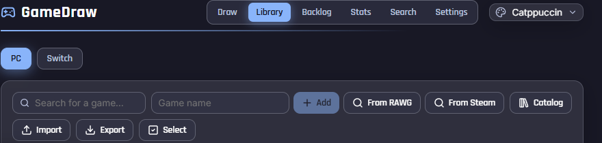
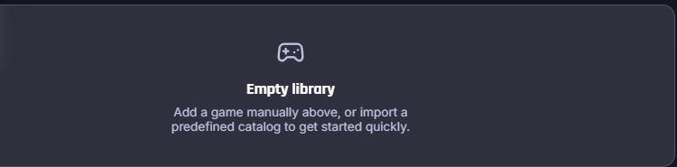
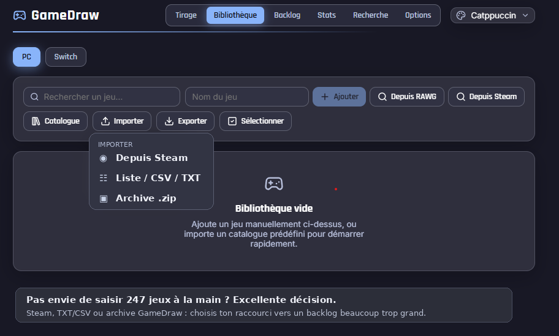
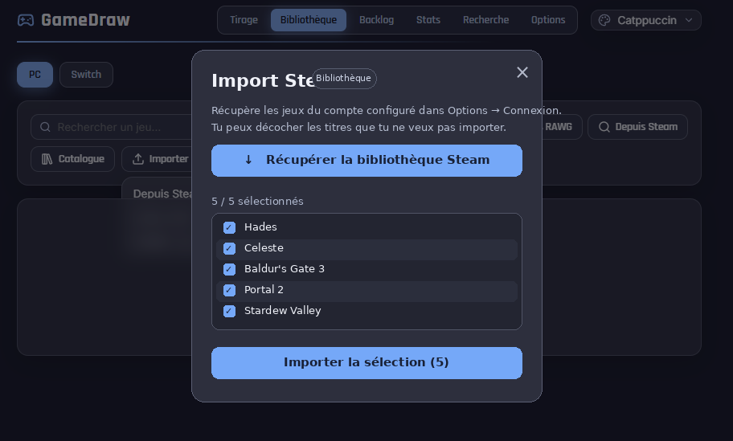
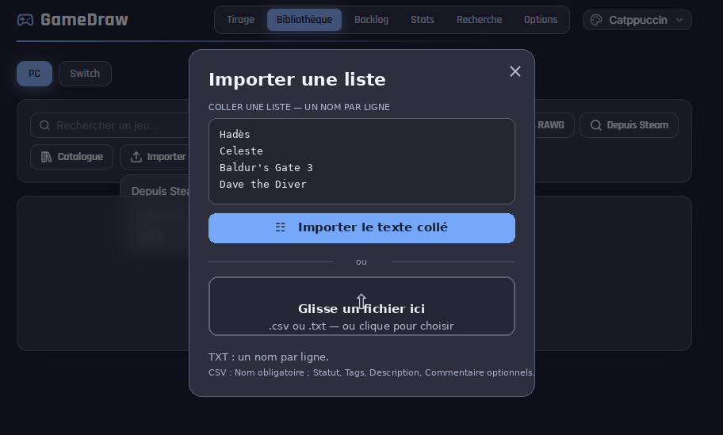

<div align="center">
  

# 🎲 GameDraw 1.0.7

> **New in 1.0.7 — Library:** bundled lists now live under **Import games → Included game lists**, with preview and confirmation; no one-click catalog import. **SteamGridDB without a key:** open the public site from the studio, copy the image URL, preview the cover, and confirm importing it. With an API key, the native gallery remains available.

**You've got games. Lots of games. GameDraw helps you decide what to play.**

*Windows · English / Français · Local-first · No GameDraw account required*

Created by **Faboulous San**.

**Documentation languages:** 🇬🇧 English (this file) · 🇫🇷 [Français — README.md](README.md).
</div>

---

> The familiar problem: “What should I play tonight?” Spend 40 minutes scrolling through your backlog, then launch the same game again. Or let GameDraw pick for you.


**Version 1.0.7 — [CHANGELOG](CHANGELOG.en.md):** new cover right-click menu, fixed SteamGridDB website access, better import confirmation and hidden publisher settings.

## 🔄 GitHub updates — GameDraw 1.0.7

**On first launch**, after selecting the application language, GameDraw asks whether it should **check GitHub for updates at startup**. Choose **Yes** or **No**: no checks happen before you make this decision, and downloads/installations always require confirmation. Your selection is saved and can be changed in **Settings → Updates**. Existing users retain their previously saved preference.

GameDraw can now check public **GitHub Releases** from **Settings → Updates**. The official repository **[FaboulousSan/GameDraw](https://github.com/FaboulousSan/GameDraw/)** is preconfigured. Choose **Stable** or **Beta**, and select **Check for updates**. Review the release notes, select a published GameDraw `.exe`/`.msi` installer and explicitly approve its download into **Windows Downloads**. Run the downloaded installer **manually** after checking the publisher.

For **new installations**, **Automatically check on startup** is explicitly offered on first launch (Yes / No); it may be changed later. **Existing preferences are preserved** when upgrading. If enabled, GameDraw checks once on launch, then shows an **animated update notification** with `current version → new version`, a preview of release notes, **View update / Later** actions, and optional Windows notification if permission was previously granted. Motion reduction follows Windows accessibility preferences. Use **Preview animated update notification** in Settings → Updates to test the interface right away, even if GitHub has no newer release; this is explicitly labelled as a preview. The installer download has a **real progress bar** showing the transferred bytes.

Disable the startup check to stop automatic GitHub requests; manual checks remain available. Neither downloads nor installations happen silently. No older release is offered as an update.

Fully automatic in-app installation requires a cryptographically signed **Tauri updater** with an official publisher public key and signed release assets. See the [beta integration contract](docs/IMPORT-BETA-UPDATER-1.0.5.md) and [English update guide](docs/MAJ-GITHUB-1.0.5-EN.md).


## 👀 A quick look

### 📚 Your game library

<p align="center"></p>

Organize your PC and Switch games, assign play statuses and ratings, track completion, add tags and personal notes, and make the backlog useful rather than intimidating.

### 🌱 Starting with an empty library

<p align="center"></p>

Start by importing a list, connecting to Steam, or adding games manually. You don't need to set up any online account just to use GameDraw.

---

> **Historical screenshot:** the import menu screenshot below predates v1.0.7. Use the single **Import games** button in the current release.

# 📥 Import your games

Go to **Library → Import games** after selecting your target library (**PC** or **Switch**).

<p align="center"></p>

| Import method | What it does | Use it when… |
|---|---|---|
| **From Steam** | Imports eligible owned games from a configured Steam account | Your PC games are already on Steam |
| **TXT list** | Imports one game title per line | You have a simple Notepad list |
| **CSV list** | Imports titles and optional statuses, tags, descriptions, comments | You want to organize your collection immediately |
| **GameDraw ZIP archive** | Imports an exported GameDraw library and its cover images | You are restoring or transferring a library |

GameDraw skips duplicate names during list imports so you do not end up with the same title multiple times.

## 🎮 Importing from Steam

1. Open **Settings → Connections** and enter your **Steam Web API key** and **SteamID64**.
2. Go to **Library → Import → From Steam**.
3. Choose **Retrieve Steam library** and select the games you want.
4. Select **Import selection**.
5. Return to the relevant library to see the imported titles.

<p align="center"></p>

If nothing is returned, check the Steam account identifiers and whether its games are visible to the API.

## 📝 Importing a `.txt` file — step by step

**No API key is needed.** The text file should contain **one game title per line**.

### 1. Make a list in Windows Notepad

Copy or type:

```text
Hades
Celeste
Baldur's Gate 3
Dave the Diver
Stardew Valley
```

Select **File → Save as** in Notepad. Name the file `my-pc-games.txt` or `my-switch-games.txt`, choose **UTF-8** encoding, and save it to a place you can find (Desktop or Downloads). If Windows adds `.txt` again, use *All files* under the file type selector.

Check that the final name is `.txt`, not `.txt.txt`.

Sample files: [`docs/examples/exemple-jeux.txt`](docs/examples/exemple-jeux.txt) and the [ready-to-import Switch and PC collections](docs/examples/listes-jeux/README.md).

### 2. Open the import dialog

Follow **Library → choose PC or Switch → Import → List / CSV**.

<p align="center"></p>

The chosen library matters: the games go into **that** PC or Switch library. For Switch 1 and Switch 2 titles, you can tag the games to distinguish generations.

### 3. Select or paste the list

In the **Import a list** dialog, click the file/drop area and select your `.txt`, or drag the file onto it. Alternatively, paste the titles directly into the text area and select **Import pasted text**.

<p align="center"></p>

### 4. Check the imported games

Open the PC or Switch library that you selected. Imported games can then receive cover images, ratings, tags and statuses and can be included in random draws. If nothing appears, check the selected platform and active filters.

More details, including CSV, are available in the [TXT/CSV import guide (French)](docs/GUIDE-IMPORT-TXT-CSV.md).

## 📊 Importing a `.csv` file

Use **Library → PC or Switch → Import → List / CSV** and select the `.csv` file.

A `Nom` (name) column is required; the supported optional columns include `Statut` (status), `Tags`, `Description`, and `Commentaire` (comment). For maximum compatibility use the actual import column names:

```csv
Nom,Statut,Tags,Description,Commentaire
Hades,Terminé,"roguelike,action",Underworld escape,Replay later
Celeste,En cours,"platformer,indie",Mountain climb,Chapter 7
```

GameDraw 1.0.4 accepts **commas and semicolons**, quoted fields, and UTF-8 files with a BOM, including many CSV exports from French-language Excel installations:

```csv
Nom;Statut;Tags
"Super Mario Odyssey";En cours;"Switch 1, Mario"
"Celeste";Non commencé;"platformer;indie"
```

See [`docs/examples/exemple-jeux.csv`](docs/examples/exemple-jeux.csv).

### 🎁 Included starter packs

| Platform | TXT | CSV | Titles |
|---|---|---|---:|
| Switch 1 | [TXT](docs/examples/listes-jeux/jeux-switch-1.txt) | [CSV](docs/examples/listes-jeux/jeux-switch-1.csv) | 60 |
| Switch 2 | [TXT](docs/examples/listes-jeux/jeux-switch-2.txt) | [CSV](docs/examples/listes-jeux/jeux-switch-2.csv) | 40 |
| Switch 1 + 2 | [TXT](docs/examples/listes-jeux/jeux-switch-1-et-2.txt) | [CSV](docs/examples/listes-jeux/jeux-switch-1-et-2.csv) | 100 |
| PC | [TXT](docs/examples/listes-jeux/jeux-pc.txt) | [CSV](docs/examples/listes-jeux/jeux-pc.csv) | 60 |

These are starter selections, not an exhaustive collection. TXT files contain titles, whereas CSV files also carry platform tags.

## 📦 Importing a GameDraw ZIP archive

Use **Library → Import → ZIP archive** to restore a previously exported library and its images. For an entire-application backup, including preferences and history, use **Settings → Data → Backup** instead.

---

# 🖼️ Game cover images

Open **Library → select a game → Edit (pencil icon)**. You can:

- Select **Choose a file** for a local PNG, JPEG, WEBP or GIF image.
- Search **Steam** (no key for game cover search), **RAWG** (API key), or **SteamGridDB** (API key).
- Paste a direct image URL, then select **Apply** to download and save the cover locally.

## 🔍 SteamGridDB artwork studio — HF5 (GameDraw 1.0.4)

Open **Library → select a game → Edit (pencil icon) → SteamGridDB studio · find artwork**. A **native top-layer dialog** opens in GameDraw. Its Close button and Escape key remain available at small window sizes and 125/150% Windows scaling, with independently scrollable content.

**With a SteamGridDB API key:**

1. Go to **Settings → Connections**, enable SteamGridDB, enter your **own SteamGridDB API key** (not a Steam Web API key) and click **Test SteamGridDB connection**. The input is hidden by default.
2. Open the game's details, select **Edit**, then **SteamGridDB studio**.
3. Search by title and choose the **correct game** from the matches. Game editions and similar titles are listed separately.
4. Browse **Portrait / Landscape / Square** artwork and use **Next** / **Previous** to move through pages.
5. Click **Use** beneath the image you want. GameDraw downloads and validates the **original image**, stores it locally and updates the game cover. Reopen the game after restarting to verify persistence.

**Without an API key:** choose **Browse SteamGridDB in GameDraw**. The public website opens in a **GameDraw-managed WebView2 window**; you can browse game artwork without an API key. On the chosen image, use **Copy image address** and paste the **direct HTTPS image URL** into the studio, or choose **Save image** and import the local file. **External browser** remains a fallback if the website does not load in WebView2. After applying, close the studio; your artwork is saved in the library. The public site is not the API: automatic access to its image catalogue requires a valid SteamGridDB API key. No web scraping or unofficial API bypass is used.

**Errors:** HTTP `401` = API key refused, `403` = permission denied, `429` = rate limit, timeout = connection issue. Manual image import remains available in all cases. The application does not include API credentials in its error logs.

**Note:** You can use landscape or square artwork as a cover, but GameDraw's library cards are mostly portrait-shaped. Choose Portrait for the most consistent appearance.

---

# 🚀 Installing or running GameDraw on Windows

| Build | Typical output | Suitable for |
|---|---|---|
| NSIS installer | `GameDraw_1.0.4_x64-setup.exe` | Standard guided installation |
| MSI installer | `GameDraw_1.0.4_x64_en-US.msi` | Windows Installer workflows |
| Portable executable | `Portable\GameDraw.exe` | Run without an installer |

The exact filename may vary according to the packaging tools. To use portable mode, launch the executable from its supplied folder. User data still lives in the Windows user profile rather than beside the executable.

## 🌍 First run and language choice

GameDraw detects the Windows language and suggests **English** or **Français**. You can change the language later under **Settings → About** (in French: **Options → À propos**).

---

# 🎲 Features

**Random game draws:** filter games, draw one or several titles, avoid repetition, use roulette-style options, choose among 20 draw animations and 42 reveal effects, and configure timed sessions.

**Library management:** record statuses, personal ratings, tags, comments, played hours, challenges, favorites, plans to play, progress, endings, and 100%-completion flags.

**Backlog:** find games waiting to be played or completed.

**Statistics:** draw history, platform breakdowns, progress, heatmaps, rating coverage, and regularity.

**Achievements:** in-app achievements for interacting with your gaming library.

**Adding games individually:** add a title manually or look it up using the supported Steam / RAWG sources or predefined catalogues.

---

# 💾 Data and backups

GameDraw is **local-first**. By default, Windows application data is stored under:

```text
%APPDATA%\com.sensei.gamedraw\
```

Use **Settings → Data** for backup and restore. Make a backup before moving to another PC or manually changing files. Internet access is used when you deliberately perform online operations such as Steam imports and cover searches; a GameDraw login is not required.

## ⌨️ Shortcuts

| Key | Action |
|---|---|
| `Space` | Start a random draw |
| `1` through `6` | Switch application view |
| `Escape` | Close supported dialogs |
| Right click | Open available context menus |

## 🎨 Appearance and Windows icons

You can change themes, effects, sounds, transitions and interface density. The **white transparent icon** is the default Windows executable/desktop/taskbar icon; a **dark alternative** is available from appearance settings for the app window. For a desktop shortcut, use **Right click → Properties → Change Icon → Browse** and choose `GameDraw-Light.ico` or `GameDraw-Dark.ico` from the supplied Windows icon files.

If the taskbar still displays a previous icon, close GameDraw, unpin the old shortcut and pin the updated executable. Windows caches shortcut icons.

## 🪟 Integrated Windows window frame

GameDraw 1.0.4 uses a custom top bar that matches the application theme, with minimize, maximize/restore and close buttons. Drag an empty area of its header to move the window. Timed sessions retain their close confirmation.

---

# 🛟 Troubleshooting

- **Cannot import a list?** Confirm that you selected the intended PC/Switch library, the extension is `.txt` or `.csv`, and the file is UTF-8. Check active filters and duplicate titles.
- **No cover appears?** Try **Edit → Choose a file**, or a valid direct image URL. The replacement thumbnail indicates a missing or unsupported source.
- **SteamGridDB search does not work?** Confirm the source is enabled and the SteamGridDB API key is valid. API HTTP 401 is a credential error. Use the website through your usual browser as an alternative.
- **Steam library import is empty?** Check SteamID64, Steam Web API key and privacy settings.
- **App looks different after an update?** Windows can cache icons; restart and update pinned shortcuts.
- **Need logs?** Check the local GameDraw diagnostic log under your application data directory. Keep a backup before any manual cleanup.

For development or Windows packaging, refer to [the DEV-HUB V2 guide](docs/GameDraw-DEV-HUB-V2.md) and [Windows release test plan](docs/RECETTE-DEVHUB-WINDOWS-v1.0.4.md).

## 🔐 Privacy

The application primarily uses local storage and only contacts supported online services for actions you request. You do not need to register a GameDraw account to use the random game picker.

## 👤 About

**GameDraw 1.0.4**  
Created by **Faboulous San**  
© 2026 Faboulous San. All rights reserved.

---

<div align="center">**🎲 Have fun — GameDraw picks the game. Playing it is still up to you.**</div>


### DEV-HUB troubleshooting — early self-test exit code 76 (HF2)

If the self-test stops immediately with an invalid manifest error, HF2 restores
Windows CRLF line endings for the project manifest and adds a precise check
which also accepts LF/UTF-8 BOM without modifying the project:

```powershell
node .\tools\devhub-manifest-check.mjs
.\DEV-AUTO.bat --devhub-selftest
```

Any `[MANIFEST][ERREUR]` output identifies the failing field. Do not delete
your game libraries or cover art to fix this error.


## GameDraw 1.0.5 HF3 — Windows polish and Library actions

### High-quality Windows icons
The default light/white GameDraw icon is embedded in the executable and new shortcuts. A dark alternative is also included. Each ICO embeds **11 transparent PNG frames from 16 to 256 px**. Small Windows icons (16/20/24/32 px) now use a purpose-drawn, simplified controller glyph for maximum legibility. Larger sizes retain the high-resolution artwork.

Windows decides the physical size of taskbar icons; an app cannot force a larger size. To refresh an existing pinned icon, close GameDraw, unpin the old shortcut, then pin the new executable. You can also use **Shortcut → Properties → Change Icon** and select `GameDraw-Light.ico` or `GameDraw-Dark.ico` from the release deliverables.

### Library right-click menu
Right-click a game to **Open/Edit**, **Duplicate**, **Set status**, **toggle favorite / want to play / 100% / draw cycle**, **add tags**, or **Delete** with confirmation. Long menus scroll within the window and support keyboard navigation with arrow keys and Escape.

For bulk actions, enable **Select**, select several games, then right-click **one of the selected games**. Status and flag changes apply to the selected games only. Adding tags preserves existing tags and skips duplicates. The selection bar also offers quick bulk actions.

### Full data deletion — safe and visible
Under **Options → Data → Delete all data**, GameDraw shows a playful confirmation dialog. You must type `SUPPRIMER` to confirm. After successful deletion, a success message and **Close GameDraw now** button appear. **Fully close and restart GameDraw** before making further changes. Backing up your data first is strongly recommended.

### Better-looking Settings
The Updates screen now shares GameDraw's button, input, toggle and card design instead of using browser-default widgets. Animations respect the reduced-motion preference.


## Bundled game lists — GameDraw 1.0.7 HF1

The Windows app includes the game's starter CSV lists **inside the executable build**. Go to **Library → Import → Included game lists (full)**. Choose **PC (60)**, **Switch 1 (60)**, **Switch 2 (40)**, **Switch 1+2 (100)**, or **PC + Switch (160)** to import both platforms in one go. Review the preview and confirm. Duplicates are skipped, existing covers and game properties remain unchanged, and Switch 1/Switch 2 tags are preserved. The lists are starter selections, **not an exhaustive catalog of every published game**. You can still import your own TXT/CSV files.

### Taskbar icon sharpness

GameDraw keeps an 11-size RGBA Windows ICO for its EXE and shortcuts, and now applies a **256 px** window icon at startup rather than replacing it with a 64 px image. This improves high-DPI rendering and optical coverage. Windows controls the **actual height and icon/button size** of the system taskbar; GameDraw does not change Windows taskbar settings. If only the GameDraw icon seems small or unchanged after an update, remove the old pinned shortcut and pin the new executable.


### Public SteamGridDB: cover art without an API key (1.0.6 HF3)

Open a game's details → **SteamGridDB studio → Browse SteamGridDB in GameDraw**. Find an artwork on the public website, then **right-click the image → Copy image address** in the browser. Return to the studio and click **Import copied image**. If WebView2 blocks clipboard access, paste the direct URL into the field with **Ctrl+V** and click **Apply**, or save the image file and import it. The built-in API gallery with multiple thumbnails still requires an API key. GameDraw does not inject privileged commands into third-party websites.

**Game details window:** a native responsive dialog now keeps its action bar and close button accessible even when scrolling or at Windows 125/150% DPI. Escape closes it.

**Update permission:** on a fresh install, the Yes/No prompt appears after language selection. Existing configs with no recorded answer receive the prompt once on the first HF3 startup. The choice is persisted.
